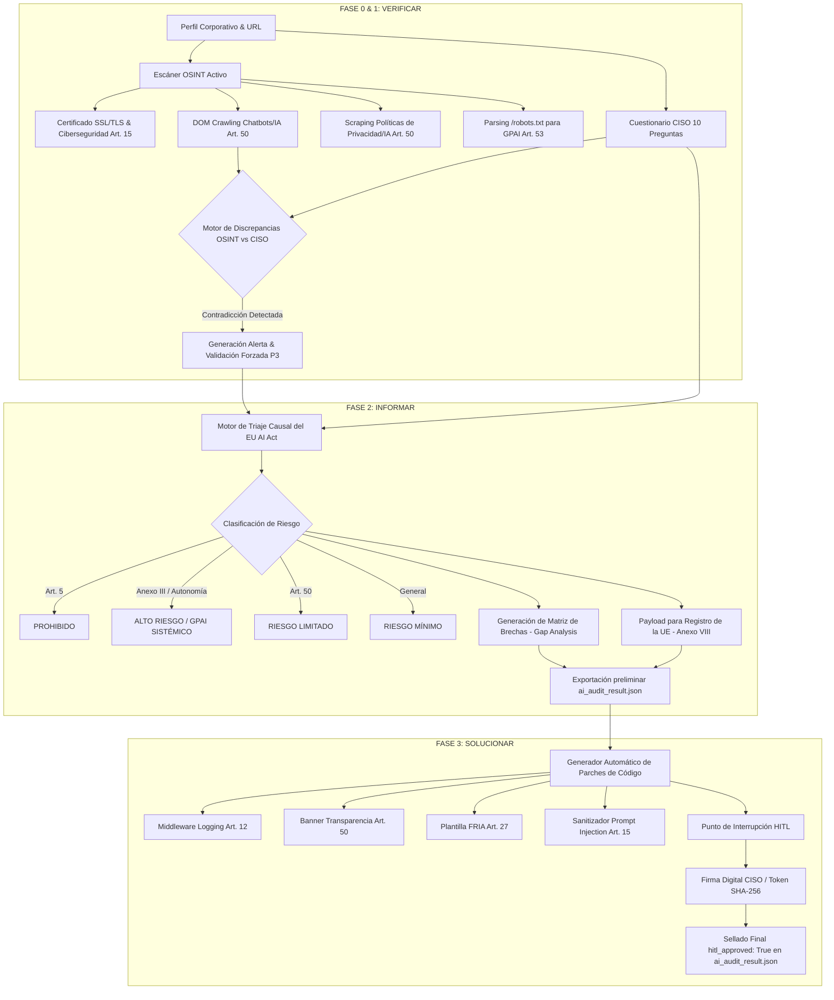

# MANUAL TÉCNICO Y DE ARQUITECTURA: MOTOR DE AUDITORÍA Y REMEDIACIÓN EU AI ACT (`ai_compliance_engine.py`)

**Versión:** 2.0.0-Production  
**Autor:** Principal Legal-Tech Architect & Lead AI Governance Engineer  
**Marco Legal:** Reglamento (UE) 2024/1689 de Inteligencia Artificial (EU AI Act) y Anexos (III y VIII)  
**Entorno:** Python 3.11+ | Pydantic v2 | Requests | BeautifulSoup4  

---

## 1. INTRODUCCIÓN Y PROPÓSITO

`ai_compliance_engine.py` es una plataforma automatizada de auditoría, gobernanza y remediación técnica diseñada para evaluar sistemas de Inteligencia Artificial frente a las obligaciones exigidas por el **Reglamento (UE) 2024/1689 (EU AI Act)**.

A diferencia de los analizadores estáticos convencionales, el motor opera mediante una arquitectura dinámica de 3 FASES (**VERIFICAR -> INFORMAR -> SOLUCIONAR**) que combina inteligencia de fuentes abiertas (OSINT Reconnaissance), interrogatorio de cumplimiento CISO/CTO, validación de discrepancias en tiempo real, generación automática de parches de código/documentación y sellado criptográfico mediante firmas digitales Human-In-The-Loop (HITL).

---

## 2. ARQUITECTURA GENERAL Y FLUJO DE DATOS



---

## 3. COMPONENTES Y MÓDULOS DEL MOTOR

### 3.1 Módulo OSINT Activo (`OSINTScanner`)
Analiza dinámicamente el dominio corporativo del sistema de IA:
1. **Auditoría SSL/TLS & Cabeceras (Art. 15):** Verifica la validez del certificado, la fecha de expiración y comprueba la presencia de HSTS, CSP, X-Frame-Options y X-Content-Type-Options asignando una puntuación de ciberseguridad (0-100).
2. **Análisis del DOM para Transparencia (Art. 50):** Inspecciona el árbol HTML/JS rastreando librerías o widgets de Chatbots (Intercom, Drift, OpenAI, Crisp, Zendesk, etc.).
3. **Scraping de Políticas e IA (Art. 50):** Localiza enlaces a Políticas de Privacidad/Avisos Legales e inspecciona el texto en busca de menciones explícitas a Inteligencia Artificial o Modelos de Lenguaje.
4. **Parsing de `/robots.txt` para GPAI (Art. 53):** Examina las directivas `Disallow` / `Allow` frente a crawlers de IA de propósito general (`GPTBot`, `ClaudeBot`, `PerplexityBot`, `Bytespider`, `CCBot`).

### 3.2 Motor de Alertas de Discrepancias (Cross-Check)
Compara la evidencia técnica obtenida en OSINT frente a las declaraciones del CISO. Si OSINT detecta un chatbot conversacional en el DOM y el CISO responde "No" a la P3 (Transparencia), el motor emite la alerta `DISC-P03`, fuerza la respuesta a `P3=True` y registra la incoherencia en el informe legal.

### 3.3 Generador Automático de Parches (`RemediationGenerator`)
Para cada incumplimiento detectado, el motor compila y escribe en disco parches listos para producción:
- **`eu_ai_act_logging_middleware.py` (Art. 12):** Middleware Python/FastAPI con retención de logs inmutables por 6 meses.
- **`ai_transparency_notice.html` (Art. 50):** Componente HTML/JS con aviso de interacción con IA y marcas de agua de metadatos C2PA.
- **`fria_assessment_template.md` (Art. 27):** Documento borrador en Markdown para la Evaluación de Impacto en los Derechos Fundamentales.
- **`prompt_injection_sanitizer.py` (Art. 15):** Módulo de ciberseguridad para desinfección de prompts y prevención de alucinaciones.

### 3.4 Protocolo de Firma y Aprobación HITL (Human-In-The-Loop)
Exige la intervención y firma explícita del CISO/CTO/AI Lead. Calcula un hash criptográfico SHA-256:
$$\text{Signature} = \text{SHA256}(\text{CISO\_Name} \parallel \text{Website\_URL} \parallel \text{Risk\_Level} \parallel \text{Timestamp} \parallel \text{Salt})$$
Sellando el expediente final `ai_audit_result.json` con `hitl_approved: True`.

---

## 4. INSTRUCCIONES DE DESPLIEGUE Y USO

### Ejecución Interactiva por Terminal:
```bash
python ai_compliance_engine.py
```

### Ejecución Automatizada para Pipelines CI/CD:
```bash
python ai_compliance_engine.py --non-interactive --url "https://empresa.com" --company-name "Empresa S.A." --ciso-name "Laura CISO" -o "ai_audit_result.json"
```

---

## 5. ESTRUCTURA DEL EXPEDIENTE RESULTANTE (`ai_audit_result.json`)

El archivo JSON incluye la totalidad del expediente:
- `profile`: Datos de la empresa y del responsable CISO.
- `osint_report`: Certificado SSL, cabeceras, detección DOM de chatbots y estado de `/robots.txt`.
- `discrepancies`: Lista de incoherencias OSINT vs. CISO.
- `questions`: Respuestas al cuestionario de 10 preguntas.
- `overall_risk`: Nivel de riesgo asignado por el triaje.
- `findings`: Brechas legales identificadas.
- `remediation_patches`: Parches de código y plantillas generadas.
- `annex_viii_payload`: Payload estructurado para la base de datos de registro de la UE.
- `hitl_approved`: `True` cuando ha sido aprobado y sellado por el responsable.
- `signature_token`: Hash SHA-256 criptográfico de sellado.
