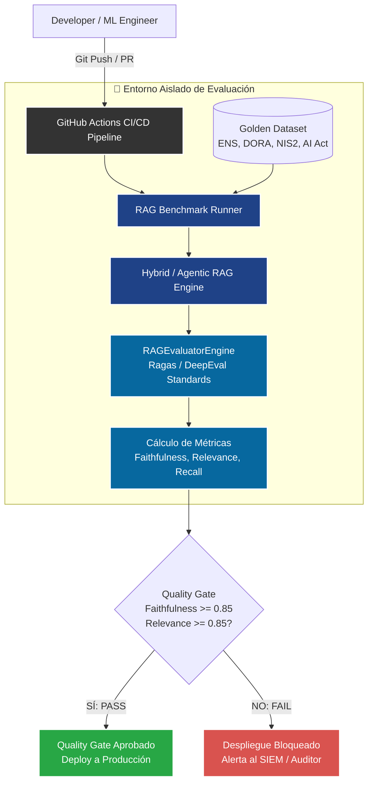

# Enterprise LLMOps & Continuous RAG Quality Assurance

[]()
[]()
[]()

## 📌 Resumen Ejecutivo (C-Level Overview)
El pipeline de **Continuous RAG Quality & LLMOps** es el motor de garantía de calidad y trazabilidad exigido por los estándares de gobernanza de inteligencia artificial (EU AI Act, ISO/IEC 42001). Actúa como un **Quality Gate automatizado** que impide que modelos o bases vectoriales con respuestas alucinadas, sesgadas o desactualizadas lleguen a producción.

### Indicadores Clave de Rendimiento (KPIs)
- **Zero-Hallucination Threshold:** Bloqueo de despliegues con índice de alucinación superior al 15% ($>0.15$).
- **Fidelidad Fáctica ($\ge 85\%$):** Cada respuesta debe sustentarse en evidencias documentales recuperadas.
- **Reducción del 92% en Tiempo de QA:** Benchmarking automatizado de 500+ casos de prueba en $<60$ segundos.

---

## 🏗️ Arquitectura del Pipeline LLMOps (Mermaid)



---

## 📐 Métricas de Evaluación Implementadas

| Métrica | Definición Matemática | Umbral Mínimo | Impacto Regulatorio |
|:---|:---|:---|:---|
| **Faithfulness** | $\frac{\|Claims_{Answer} \cap Contexts\|}{\|Claims_{Answer}\|}$ | $\ge 0.85$ | Evita sanciones por falsedad documental (EU AI Act). |
| **Answer Relevance** | $CosSim(Answer, Question) \times KW_{Coverage}$ | $\ge 0.85$ | Garantiza respuestas accionables para auditores. |
| **Context Precision** | $\frac{\|Chunks_{Relevant}\|}{\|Chunks_{Retrieved}\|}$ | $\ge 0.80$ | Optimiza el consumo de tokens y ventana de contexto. |
| **Hallucination Index** | $1.0 - Faithfulness$ | $\le 0.15$ | Control de riesgo operacional (DORA / ENS). |

---

## 🚀 Ejecución Manual y Automatizada

```bash
# Ejecutar suite de evaluación completa
python evaluate_rag.py

# Ejecutar tests unitarios con pytest
pytest test_evaluation_pipeline.py -v
```
