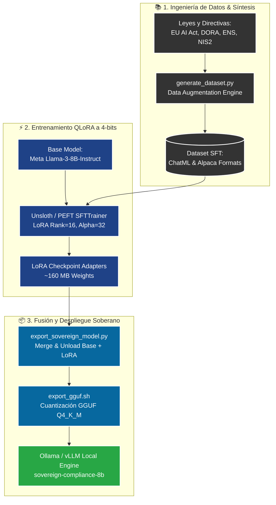

# Sovereign Compliance Model Fine-Tuning (LoRA / PEFT)

[]()
[]()
[]()
[]()

## 📌 Resumen Ejecutivo (C-Level Overview)
El módulo de **Fine-Tuning de Modelos Soberanos** dota a la organización de capacidad de entrenamiento y adaptación propia de modelos fundacionales (Llama 3 8B, Mistral 7B) sin depender de APIs de terceros en la nube (OpenAI, Anthropic).

### Ventajas Estratégicas y Soberanía del Dato
- **Cumplimiento Estricto ENS Alta y RGPD:** Inferencia y entrenamiento en infraestructuras *on-premise* o nubes soberanas europeas (Air-Gapped), garantizando que ningún dato clasificado salga de la jurisdicción de la UE.
- **Reducción de Costes Operacionales:** Coste marginal de inferencia de **$0.00 por token** al ejecutarse en servidores propios (Ollama / vLLM).
- **Especialización Normativa:** Aprendizaje intrínseco de terminología legal compleja (DORA, NIS2, EU AI Act) y formatos de auditoría sin necesidad de enviar prompts kilométricos en cada petición.

---

## 🏗️ Pipeline de Ingeniería de Datos y Entrenamiento (Mermaid)



---

## ⚙️ Especificaciones Técnicas de Entrenamiento

| Parámetro | Valor Configurado | Justificación de Ingeniería |
|:---|:---|:---|
| **Modelo Base** | `meta-llama/Meta-Llama-3-8B-Instruct` | Estado del arte en rendimiento / tamaño para despliegues locales. |
| **Técnica de Adaptación** | QLoRA (4-Bit NormalFloat NF4) | Permite entrenar en una GPU de 16GB VRAM (T4 / RTX 4090). |
| **LoRA Rank ($r$)** | 16 | Riqueza representacional para razonamiento legal. |
| **LoRA Alpha ($\alpha$)** | 32 | Escala óptima de los gradientes respecto a los pesos base. |
| **Módulos Target** | `q, k, v, o, gate, up, down_proj` | Adaptación integral de atención y capas MLP. |
| **Optimizador** | `paged_adamw_8bit` | Previene picos de memoria OOM en secuencias largas. |
| **Longitud de Contexto** | 2048 tokens | Suficiente para artículos legales y directivas completas. |

---

## 🚀 Guía Rápida de Ejecución

```bash
# 1. Generar dataset de entrenamiento
python generate_dataset.py

# 2. Iniciar pipeline de entrenamiento
python finetune_unsloth.py

# 3. Exportar Modelfile y desplegar en Ollama
python export_sovereign_model.py
```
