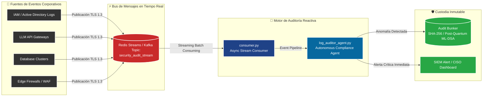

# Event-Driven AI Compliance Auditor (Real-Time Streaming)

[]()
[-red.svg)]()
[]()
[]()

## 📌 Resumen Ejecutivo (C-Level Overview)
El **Event-Driven AI Compliance Auditor** transforma la postura de cumplimiento de la organización de un modelo **pasivo/reactivo** (consultas manuales del auditor) a un modelo **activo en tiempo real (Streaming Security Intelligence)**.

El sistema monitoriza continuamente los buses de mensajería empresarial (Redis Streams, Apache Kafka, RabbitMQ) analizando millones de eventos de logs de infraestructura, autenticación IAM y llamadas a modelos de IA para detectar, clasificar y mitigar infracciones regulatorias en milisegundos con firma inmutable en el `audit-bunker`.

---

## 🏗️ Arquitectura de Streaming Reactivo (Mermaid)



---

## 📋 Matriz de Detección en Streaming y Acuerdos de Nivel de Servicio (SLAs)

| Evento de Seguridad / Cumplimiento | Marco Regulatorio | Severidad | SLA de Detección | Acción Automática |
|:---|:---|:---|:---|:---|
| **Caída de Servicio TIC Financiero** | DORA Art. 18 | `CRITICAL` | $< 200$ ms | Apertura de incidente mayor y contador para notificación 4h. |
| **Exfiltración de PII / Dump de BD** | RGPD Art. 33 | `CRITICAL` | $< 150$ ms | Aislamiento perimetral y trazabilidad de brecha forense. |
| **Prompt Injection / Jailbreak LLM** | EU AI Act Art. 15 | `HIGH` | $< 50$ ms | Bloqueo perimetral de IP y registro en Audit Bunker. |
| **Escalada no Autorizada de Privilegios** | ENS Alta op.acc.4 | `HIGH` | $< 100$ ms | Revocación inmediata de tokens de sesión activos. |
| **Paquete no Firmado en CI/CD** | NIS2 Art. 21 | `MEDIUM` | $< 500$ ms | Bloqueo preventivo de despliegue de software. |

---

## 🚀 Ejecución de Pruebas y Streaming Local

```bash
# 1. Iniciar el consumidor asíncrono
python consumer.py

# 2. Inyectar eventos de prueba con el simulador
python producer_simulator.py

# 3. Ejecutar suite de validación automatizada
pytest test_event_auditor.py -v
```
