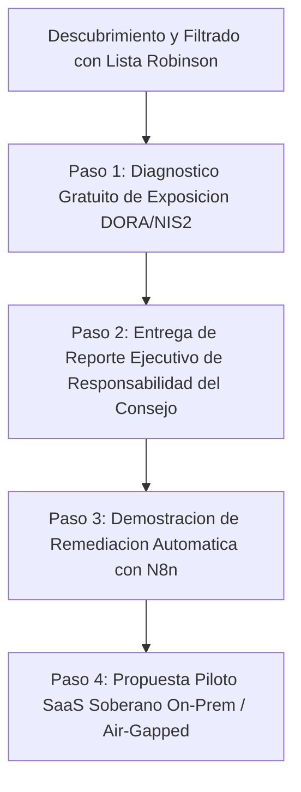

# Blueprint GTM: Outbound Machine B2B & Customer Operations para Quantigrade GCR

## 1. Misión y Posicionamiento en el Mercado Regulado
Quantigrade GCR es la plataforma soberana de GRC continuo basada en agentes para empresas reguladas de la Unión Europea bajo directivas críticas: **DORA**, **NIS2**, **ENS**, **EU AI Act**, **RGPD** y **CRA**.

El objetivo de este motor GTM autónomo (inspirado en `Outbound Machine` y `Omni Contact Center`) es estructurar una prospección B2B ética, de alta precisión y con plena defensibilidad legal (RGPD Art. 6.1.f interés legítimo y lista Robinson).

---

## 2. Segmentación de Clientes y Buyer Personas

### Segmento 1: Entidades Financieras y Seguros (Obligados DORA)
- **Target:** Bancos, gestoras de fondos, aseguradoras, pasarelas de pago y proveedores críticos de servicios TIC (CTPP).
- **Interlocutor Clave:** CISO, Chief Risk Officer (CRO), Director de Cumplimiento Normativo.
- **Pain Point Principal:** Miedo a sanciones de hasta 10M€ o 2% de facturación (DORA Art. 50), falta de trazabilidad en auditorías de resiliencia y saturación por reporting manual.
- **Hook de Venta:** *"Auditoría DORA continua con sellado de tiempo eIDAS 2.0 y calculadora actuarial de riesgo en tiempo real sin instalar Docker"*.

### Segmento 2: Entidades Esenciales e Importantes (Obligados NIS2)
- **Target:** Energía, Sanidad, Transporte, Infraestructuras Digitales, Alimentación y Fabricación avanzada.
- **Interlocutor Clave:** Miembros del Consejo de Administración, CEO, CISO.
- **Pain Point Principal:** Responsabilidad personal e inhabilitación temporal de directivos bajo Art. 20 NIS2 ante incidentes no gestionados con debida diligencia.
- **Hook de Venta:** *"Protección del Consejo de Administración (Corporate Defense Art. 31 bis CP y Art. 20 NIS2) mediante prueba forense criptográfica inmutable"*.

### Segmento 3: Desarrolladores e Integradores de IA (Obligados EU AI Act)
- **Target:** ISVs, tecnológicas sanitarias, empresas de scoring financiero y RRHH.
- **Interlocutor Clave:** Chief AI Officer, VP of Engineering, DPO.
- **Pain Point Principal:** Clasificación de alto riesgo (Art. 6) y multas de hasta 35M€ o 7% facturación por falta de supervisión humana (Art. 14) y mitigación de ciberataques LLM (Art. 15).
- **Hook de Venta:** *"Firewall de inferencia integrado con sanitizador PII y registro auditable de gobernanza para modelos fundacionales y agentes"*.

---

## 3. Secuencia de Prospección B2B Ética (Funnel de 4 Pasos)

### Paso 1: Micro-Auditoría de Exposición Externa (Lead Magnet)
- Inspección pasiva perimetral sin intrusión (cabeceras TLS, exposición de endpoints de API, registros DNSSEC, SPF/DMARC).
- Generación automática de una ficha pericial: *"Diagnóstico preliminar de cumplimiento DORA/NIS2 para [Empresa]"*.

### Paso 2: Análisis de Impacto Económico para el Consejo
- Empleo directo del módulo `LegalFinancialGuard`:
  - Cálculo de la multa máxima estatutaria según facturación pública del Registro Mercantil.
  - Dictamen pericial sobre riesgo de inhabilitación de administradores.

### Paso 3: Demostración de Remediación y Despacho Automatizado
- Mostrar cómo Quantigrade GCR pasa del hallazgo al ticket de Jira o playbook de Ansible con un clic, registrado en el Merkle Bunker.

### Paso 4: Cierre Comercial y Despliegue Soberano
- Modalidad SaaS Multi-Tenant con claves BYOK o despliegue On-Premises 100% desconectado (*air-gapped*).

---

## 4. Salvaguardas Éticas y Legales de Outbound
1. **Verificación Robinson Previa:** Ningún correo ni llamada se emite a personas o directivos inscritos en la Lista Robinson o con opt-out registrado.
2. **Legitimación RGPD Art. 6.1(f):** Envío exclusivamente a cuentas corporativas de directivos, justificado por necesidad de cumplimiento legal regulatorio.
3. **Mecanismo de Opt-Out Inmediato:** Enlace con un clic para supresión irrevocable de base de datos.
